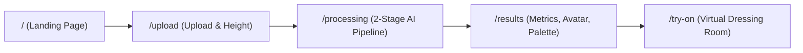
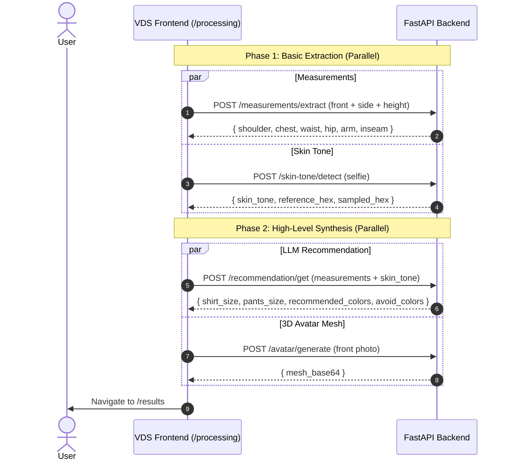

<div align="center">

# 👗 VDS Frontend — Virtual Dressing System

**Interactive React & Three.js single-page application for AI body measurement, personalized fashion styling, 3D avatar inspection, and real-time virtual try-on.**

[](https://react.dev/)
[](https://vitejs.dev/)
[](https://threejs.org/)
[](https://tailwindcss.com/)
[](https://www.framer.com/motion/)
[](https://www.netlify.com/)

</div>

---

## 📌 Table of Contents

- [Overview](#-overview)
- [Key Features](#-key-features)
- [Application Flow & Routes](#-application-flow--routes)
- [Tech Stack](#-tech-stack)
- [Project Architecture & API Pipeline](#-project-architecture--api-pipeline)
- [Environment Configuration](#-environment-configuration)
- [Offline Mock Mode](#-offline-mock-mode)
- [Getting Started](#-getting-started)
- [Production Deployment](#-production-deployment)
- [Directory Structure](#-directory-structure)

---

## 🔭 Overview

The **VDS Frontend** provides a fluid, responsive client interface for the Virtual Dressing System. Designed to eliminate the uncertainty of online clothing shopping, it allows users to upload full-body photos and personal calibration data, automatically connects with the FastAPI computer vision backend, renders an interactive 3D human body mesh, displays personalized fit recommendations, and lets users preview garments on themselves using virtual try-on technology.

---

## ✨ Key Features

- **Guided Calibration & Upload**: Intuitive drop zones for front-pose, side-profile, and face portrait photos, paired with height input sliders and visual photography guidelines.
- **Two-Stage Parallel Processing**: Asynchronous orchestrator with real-time scanning feedback and progress indicators.
- **Interactive 3D Avatar Viewer**: Renders base64 `.obj` 3D body models in the browser using Three.js and `@react-three/fiber`, featuring 360-degree orbit controls, ambient lighting, and zoom.
- **Personalized SmartFit Analysis**:
  - Detailed body measurements (chest, waist, hips, arm length, shoulder width, inseam) in centimeters.
  - Monk Skin Tone (MST) scale detector displaying classified and sampled HEX swatches.
  - Standard shirt and pants sizing predictions (`XS`–`XXL`, `W*L`).
  - Color palettes highlighting recommended shades and colors to avoid.
- **Virtual Dressing Room (`/try-on`)**: Interactive garment catalog allowing users to select apparel and view photorealistic virtual fitting results generated via Google Vertex AI.
- **Offline Mock Engine**: Instant UI development without requiring access to a live GPU backend.

---

## 🗺 Application Flow & Routes



| Route | View Component | Description |
|---|---|---|
| `/` | `LandingPage.jsx` | Product introduction, value proposition, feature highlights, and start button. |
| `/upload` | `UploadPage.jsx` | User height input and 3 photo drop zones (front body, side profile, selfie). |
| `/processing` | `ProcessingPage.jsx` | Live pipeline execution screen with animated scanning indicators and failure retry prompts. |
| `/results` | `ResultsPage.jsx` | Comprehensive dashboard featuring the 3D Avatar viewer, measurements table, skin tone card, and size recommendations. |
| `/try-on` | `TryOnPage.jsx` | Garment selection gallery and high-resolution virtual fitting results display. |

---

## 🛠 Tech Stack

| Technology | Purpose |
|---|---|
| **React 18** | UI component architecture and state management |
| **Vite 5** | High-performance build tool and hot module replacement (HMR) development server |
| **React Router v7** | Client-side routing and page transitions |
| **Three.js** | WebGL 3D rendering library |
| **@react-three/fiber & @react-three/drei** | Declarative React abstractions for Three.js canvas and camera controls |
| **Tailwind CSS** | Utility-first CSS styling and responsive layouts |
| **Framer Motion** | Page transitions, smooth micro-interactions, and scanning animations |
| **Lucide React** | Clean, modern iconography |

---

## ⚡ Project Architecture & API Pipeline

Backend integration is encapsulated in `src/lib/api.js`. When the user completes photo upload, the `/processing` page initiates a structured **two-phase parallel pipeline**:



### Fault-Tolerant Error Handling
- **Critical Pipeline Steps**: If Phase 1 (measurements/skin tone) or the recommendation step encounters an error, the processing screen displays a user-friendly retry banner without forcing the user to re-upload photos.
- **Non-Critical 3D Mesh**: If the 3D avatar generation times out or fails, the results page still renders all sizing, measurement, and color data, providing a fallback placeholder and an in-place "Regenerate Avatar" button.

---

## ⚙️ Environment Configuration

Create a `.env` file in the `frontend/vds-frontend/` directory:

```env
# URL of your deployed FastAPI backend (no trailing slash)
VITE_API_URL=https://your-space.hf.space

# Toggle offline development mode (true = use mock data, false = call live backend)
VITE_USE_MOCK=false
```

| Variable | Type | Default | Description |
|---|---|---|---|
| `VITE_API_URL` | String | `""` | Base URL of the FastAPI backend. Used by all fetch requests in `src/lib/api.js`. |
| `VITE_USE_MOCK` | Boolean | `true` | When set to `true`, all API calls return simulated delay and mock JSON responses. |

> [!TIP]
> Always restart the Vite development server (`npm run dev`) after modifying variables in `.env`.

---

## 🧪 Offline Mock Mode

To enable frontend designers and developers to build UI components without needing access to an active CUDA GPU backend:
1. Set `VITE_USE_MOCK=true` in `.env`.
2. Launch the dev server with `npm run dev`.
3. The app simulates API delays, provides realistic body measurements, classifies a representative skin tone, displays a fallback `.obj` model in `src/assets/avatar.obj`, and demonstrates virtual try-on responses.

---

## 🚀 Getting Started

### Prerequisites
- **Node.js**: `v18.0.0` or higher
- **npm**: `v9.0.0` or higher (or `pnpm` / `yarn`)

### 1. Installation
Navigate into the frontend project directory and install dependencies:

```bash
cd frontend/vds-frontend
npm install
```

### 2. Run Local Development Server
```bash
npm run dev
```
The application will start with hot module replacement at:
`http://localhost:5174` (or `http://localhost:5173`)

### 3. Production Build
To create an optimized production bundle:
```bash
npm run build
```
The compiled static assets will be output to the `dist/` directory.

### 4. Preview Production Build
```bash
npm run preview
```

---

## 🌐 Production Deployment

The project includes pre-configured settings for continuous deployment on **Netlify** via `netlify.toml`.

### Deploying to Netlify
1. Connect your Git repository to **Netlify**.
2. Set the **Base directory** to: `frontend/vds-frontend`.
3. Configure the build settings:
   - **Build command**: `npm run build`
   - **Publish directory**: `dist`
4. In **Site Configuration → Environment Variables**, add:
   - `VITE_API_URL`: Your live Hugging Face Space URL (e.g. `https://username-vds-backend.hf.space`).
   - `VITE_USE_MOCK`: `false`.
5. Trigger deployment.
6. **Important CORS Step**: Add your newly generated Netlify domain (e.g. `https://your-app.netlify.app`) to the `ALLOWED_ORIGINS` secret in your backend Hugging Face Space settings.

---

## 📂 Directory Structure

```
frontend/vds-frontend/
├── index.html                   # HTML entry point with viewport & font configurations
├── vite.config.js               # Vite build configuration & plugins
├── tailwind.config.js           # Custom theme colors, breakpoints & animations
├── postcss.config.js            # PostCSS Autoprefixer setup
├── netlify.toml                 # Netlify routing redirects & headers
├── package.json                 # Project dependencies & scripts
│
├── public/                      # Static assets served as-is
└── src/
    ├── main.jsx                 # React root mount with BrowserRouter
    ├── App.jsx                  # Main route switch & layout wrapper
    ├── index.css                # Global Tailwind CSS directives
    │
    ├── assets/                  # App logos, demo clothing garments, 3D meshes & SVGs
    │
    ├── components/
    │   ├── common/              # Shared components (FailureBanner.jsx, etc.)
    │   ├── layout/              # Navbar.jsx and Footer.jsx
    │   ├── upload/              # DropZone.jsx, PersonalCalibration.jsx, PhotoGuidelines.jsx
    │   ├── processing/          # ScanAnimation.jsx
    │   ├── results/             # Avatar3DViewer.jsx, MeasurementCard.jsx, SkinToneCard.jsx, ColorPalette.jsx
    │   └── tryon/               # AvatarPanel.jsx, SmartFitSelection.jsx
    │
    ├── hooks/
    │   └── usePageFlow.jsx      # Multi-step state machine (uploads, measurements, avatar)
    │
    ├── lib/
    │   ├── api.js               # Centralized fetch client for all backend endpoints
    │   └── utils.js             # Styling and class helper utilities (clsx, tailwind-merge)
    │
    └── pages/
        ├── LandingPage.jsx      # Home route (/)
        ├── UploadPage.jsx       # Photo upload & height configuration (/upload)
        ├── ProcessingPage.jsx   # Two-stage AI pipeline execution (/processing)
        ├── ResultsPage.jsx      # Metrics, skin tone, sizing, and 3D avatar (/results)
        └── TryOnPage.jsx        # Garment try-on fitting room (/try-on)
```

---

<div align="center">
  <sub>Built with ❤️ by the Virtual Dressing System (VDS) Team</sub>
</div>
